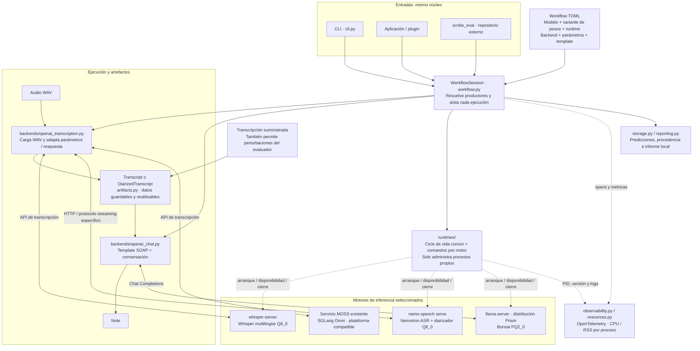

# Scribnic

Núcleo local de escriba clínico con la misma API para CLI, aplicación y evaluación.
Un workflow declara cómo producir una nota desde audio o una transcripción. Incluye
Whisper.cpp, Nemotron multilingüe + diarizador con NeMo-Speech.cpp, MOSS opcional
con Transformers o un servicio HTTP existente, y Bonsai mediante llama-server Prism.

## Arquitectura del refactor

El workflow selecciona los pasos y sus recursos. Un **modelo** identifica los pesos
y su precisión; un **backend** adapta una API de inferencia a los artefactos de
Scribnic; un **gestor de runtime** instala o localiza el motor, arranca el proceso,
espera a que esté listo y lo cierra. El motor real puede ser un ejecutable C++ o un
servicio existente. Compartir HTTP no implica compartir formatos ni capacidades.

Las rutas HTTP comparten clientes; los gestores conservan los modelos cargados:



El despliegue del médico incluye las dependencias, pesos y motores necesarios para
su workflow. El código puede conocer otros proveedores sin importar ni instalar
sus bibliotecas. El entorno de evaluación puede preparar varios workflows; los
datasets y métricas permanecen fuera de Scribnic. Un servicio externo ya instalado
no se descarga ni se termina desde el cliente.

El ciclo de vida es `setup → start → run → close`: preparar recursos en
disco, cargar los pasos seleccionados, reutilizarlos entre consultas y liberar los
procesos propios. La carga y el warmup se miden por separado de la inferencia. Los
artefactos y caches de una grabación nunca se reutilizan como estado de otra.
SGLang Omni para MOSS requiere validar la combinación concreta de modelo y
plataforma; no se promete soporte local de MOSS en AMD o Mac por usar HTTP.

## Instalar y ejecutar

Python 3.12–3.14 y [uv](https://docs.astral.sh/uv/). Desde el repositorio:

```bash
uv sync --locked
uv run scribnic setup --workflow nvidia_cpp_offline
uv run scribnic run consulta.wav --workflow nvidia_cpp_offline
```

`setup` descarga/verifica solo los recursos del workflow, sin cargar modelos.
`prepare` sigue disponible como alias. Los workflows C++ no necesitan Torch,
Transformers ni bindings de llama.cpp. Para instalar un cliente desde un wheel,
usa `pip install scribnic-0.1.0-py3-none-any.whl`; el grupo `dev` no se instala.
En un checkout, `uv sync --no-dev` excluye las herramientas de desarrollo.

El runtime oficial NeMo-Speech.cpp y Bonsai/Prism se descargan de releases fijadas
con SHA256. Whisper se compila automáticamente desde el source fijado de v1.9.5:
requiere un compilador C/C++ y CMake o `uvx`; este último obtiene CMake 4.1.0 en un
entorno de herramientas aislado. No hace falta configurar una ruta al ejecutable.

Abre el `report.html` de la ruta impresa. Conserva nota, transcripción, tiempos,
configuración, procedencia y recursos por proceso. El audio permanece en su ruta
original. El WAV debe ser PCM16, mono, 16 kHz:

```bash
ffmpeg -i entrada.mp3 -ac 1 -ar 16000 -c:a pcm_s16le consulta.wav
```

## Workflows disponibles

| Workflow | Voz | Nota / instalación opcional |
| --- | --- | --- |
| `nvidia_cpp_offline` | Nemotron 3.5 ASR Q8_0 + Nemotron 3 Diarization Q8_0; archivo por HTTP | Bonsai PQ2_0 / Prism; instalación base |
| `nvidia_cpp_streaming` | Los mismos modelos; WAV por WebSocket, sin esperas de tiempo real | Bonsai / Prism; extra `[streaming]` |
| `whisper_bonsai` / `whisper_bonsai_vad` | Whisper small multilingüe Q8_0, con VAD opcional | Bonsai / Prism; instalación base |
| `moss_bonsai` | MOSS local / Transformers | Bonsai / Prism; extra `[moss]` |
| `moss_bonsai_http` | MOSS local / Transformers | Bonsai en endpoint existente; extra `[moss]` |
| `moss_bonsai_sglang` | MOSS en SGLang Omni existente | Bonsai / Prism; instalación base del cliente |
| `bonsai_note` | Entrada de texto | Bonsai / Prism; instalación base |

```bash
# Streaming NVIDIA: solo se añade el pequeño cliente WebSocket.
uv run --extra streaming scribnic run consulta.wav --workflow nvidia_cpp_streaming

# MOSS local: sus dependencias quedan limitadas a esta instalación opcional.
uv run --extra moss scribnic run consulta.wav --workflow moss_bonsai

# MOSS servido por una instalación compatible de SGLang Omni, fuera del cliente.
SCRIBNIC_MOSS_BASE_URL=http://127.0.0.1:8000/v1 \
  uv run scribnic run consulta.wav --workflow moss_bonsai_sglang
```

Cada workflow declara los extras que necesita en esta tabla. `setup` prepara pesos
y motores, no instala paquetes Python dentro del entorno que lo invoca. Una
instalación de evaluación puede usar `uv sync --locked --all-extras`; el cliente
médico instala solo los extras seleccionados. El código de proveedores que no se
usan no carga sus bibliotecas. `uv run --no-sync` conserva un entorno ya preparado.

NeMo-Speech.cpp conecta ASR y diarización por atribución temporal de palabras.
No implementamos aquí el ASR enmascarado por hablante de NeMo/Python; la referencia
Python anterior se retiró del núcleo, junto al extra `[nvidia]`. Esa diferencia de
estrategia y la cuantización impiden tratar sus resultados como equivalentes en
calidad. [NVIDIA: servidor, modos y profiling](docs/nvidia.md).

MOSS/SGLang se integra como servicio externo: Scribnic no instala SGLang ni reclama
medir recursos de otro host. Las rutas de MOSS documentadas por sus autores cubren
CUDA y GPU Intel; no hemos validado MOSS/SGLang en AMD o Mac. La opción Transformers
local sigue disponible. [MOSS: configuración y límites](docs/moss.md).

## API Python: carga separada de inferencia

```python
from scribnic import AudioFile, Transcript, open_workflow

with open_workflow("nvidia_cpp_offline") as scribe:
    startup = scribe.start()  # Opcional: carga y warmup antes de medir consultas.
    result = scribe.run(AudioFile("consulta.wav"), output_dir="runs/consulta")
    print(result.note.text)

    speech = scribe.run(AudioFile("otra.wav"), output="diarized_transcript")
    plain = speech.transcript.without_speakers()
    ablation = scribe.run(plain)  # Solo nota sobre el texto suministrado.
    manual = scribe.run(Transcript.from_text("Paciente: tengo tos desde ayer."))
```

`start(source_kind="transcript")` carga solo lo necesario para esa entrada. Devuelve
los tiempos y recursos del arranque para guardarlos por separado en evaluación.
`run` también arranca servicios bajo demanda si no se llamó a `start`. La CLI cierra
la sesión tras una ejecución; la app o el evaluador mantienen una sesión para varios
audios. `close` cierra solo procesos propios, nunca servicios externos.

Los modelos permanecen cargados; cada grabación recibe estado de reconocimiento y
artefactos nuevos. `without_speakers()` conserva texto y tiempos, elimina identidades
y roles mediante una copia explícita. Speaker IDs y roles clínicos son conceptos
distintos. El modelo de nota recibe exactamente la transcripción suministrada.

`open_workflow(..., prepare=False)` evita preparar recursos de pasos que no lleguen
a ejecutarse. `download=False` exige caché. Las llamadas de una sesión se serializan;
el harness controla la concurrencia según la memoria disponible. Datasets, jueces,
perturbaciones y métricas de calidad pertenecen a `scribe_eval`, fuera del núcleo.

Para evaluación paralela, cada worker puede mantener su propio proceso Python y
una `WorkflowSession` residente. Las sesiones comparten la caché en disco, pero
cada una arranca sus servidores propios bajo demanda, con PIDs y puertos distintos
si no se fija un puerto. Sus estados de inferencia y artefactos permanecen separados;
la RAM necesaria aumenta con las réplicas. Cada muestra necesita su directorio de
resultados. Una sola sesión serializa sus llamadas, incluso desde varios hilos.

Si varios workers configuran la misma URL externa, comparten el servidor: crear
clientes no crea réplicas del modelo. El harness deberá limitar peticiones en vuelo
y distinguir latencia por consulta de throughput total. Actualmente Bonsai se
lanza con un slot y NVIDIA con batching desactivado; los gestores propios no
configuran un servicio compartido para alta concurrencia.

Preparar primero los workflows con `setup`, y después abrir workers con
`download=False`, evita instalaciones concurrentes: la extracción y compilación de
runtimes todavía no tienen bloqueo entre procesos. No hay un pool ni reparto
automático de CPU/RAM en Scribnic; el harness debe fijar workers e hilos por runtime.
Para esos experimentos conviene registrar también recursos de la máquina completa:
los informes individuales no representan por sí solos el consumo total concurrente.

## Configuración y CLI

Un paso selecciona su **backend**, modelo y runtime de forma explícita:

```toml
name = "consulta"
default_output = "note"

[steps.speech]
backend = "openai_transcription"
model = "nemotron-3.5-asr-streaming-0.6b.q8_0"
runtime = "nemo_cpp"
output = "diarized_transcript"

[steps.speech.companions]
diarization = "Nemotron-3-Diarization.q8_0"

[steps.note]
backend = "openai_chat"
model = "Ternary-Bonsai-2-2B-PQ2_0"
runtime = "llama_cpp_prism"
template = "soap_es"
source = "speech"

[steps.note.model_settings]
temperature = 0.0
```

El preset del modelo declara entradas, salidas y formato de respuesta. El workflow
puede sobrescribir ajustes y solicitar una salida compatible. El resolver detecta
productores ausentes, ambigüedades y ciclos antes de preparar modelos. Un archivo,
`default.toml` o el único workflow de una carpeta determinan la selección.

Migración: `backend` pasa del modelo al paso; los IDs de variantes de Nemotron y
Bonsai incluyen cuantización; `http` se llama `external_endpoint`. El motor
`llama_cpp` sigue siendo una familia de servidores: el preset `llama_cpp_prism`
selecciona explícitamente el fork y la versión compatibles con Bonsai PQ2_0.

```bash
# Detenerse en el artefacto de voz.
uv run scribnic run consulta.wav --workflow nvidia_cpp_offline \
  --output diarized_transcript --output-dir runs/voz

# Generar nota desde un artefacto guardado, sin reconocimiento de audio.
uv run scribnic run runs/voz/diarized_transcript.json --workflow bonsai_note

# JSON en stdout; progreso en stderr.
uv run scribnic run conversacion.txt --workflow bonsai_note --format json
```

`--offline` exige recursos locales, pero permite llamar al endpoint seleccionado;
no es un bloqueo de red. `--profile` añade profiling detallado cuando el motor lo
permite. Sampling, templates, dispositivos e hilos se configuran en TOML.
El preset `external_endpoint` admite `SCRIBNIC_BASE_URL` y `SCRIBNIC_API_KEY`.

Bonsai usa el [perfil publicado para modelos pequeños](https://github.com/PrismML-Eng/Bonsai-demo/blob/main/SMALL-MODELS.md),
con thinking desactivado. Los workflows de voz C++ usan `temperature=0` como baseline.
Las entradas que exceden el límite configurado se rechazan sin truncar; una nota
incompleta o con thinking tampoco se acepta. La calidad clínica queda por evaluar.

## Observabilidad y resultados

Se guardan los artefactos realmente producidos, `result.json`, `run.json`,
`report.html`, diagnósticos `runtime/*` y telemetría OTLP en `telemetry/*.jsonl`.
Cada etapa se persiste antes de comenzar la siguiente. Un fallo expone el resultado
parcial mediante `WorkflowRunError.result`. Los resultados existentes no se pisan.

Se muestrean CPU y RSS de Python **y de cada proceso propio**: `nemo-speech`,
`whisper-server` y `llama-server`. El informe identifica los ejecutables; el JSON
incluye el pico de la suma RSS de cada muestreo. Esa suma puede contar páginas
compartidas varias veces y no equivale a RAM física ni VRAM. No se suman máximos
individuales tomados en momentos distintos.

Los servidores nativos conservan logs y procedencia; `--profile` declara que no
captura operadores C++ con Torch. MOSS/Transformers permite trazas de operadores
comprimidas para Perfetto; instrumentar y exportar añade tiempo y memoria. Los
benchmarks de latencia se ejecutan sin esa captura y separan carga de inferencia.

La biblioteca usa APIs OpenTelemetry; la app o el harness configuran SDK/exporters.
`scribnic.observability.Telemetry` proporciona exportación local opcional sin
reemplazar el proveedor global del proceso anfitrión.

## Desarrollo

```bash
uv sync --locked --all-extras
uv run ruff check src tests
uv run ruff format --check src tests
uv run python -m unittest discover -s tests -v
```

Las pruebas ordinarias usan fakes, no descargan modelos ni contactan servicios de
inferencia. El test real de MOSS se activa mediante `SCRIBNIC_LIVE_TESTS=1` y
`SCRIBNIC_TEST_AUDIO`. Las reglas de responsabilidades, documentación y estilo están
en [AGENTS.md](AGENTS.md). Validación de modelos y binarios: WSL/Linux x86_64 CPU;
los assets de macOS/Windows están configurados, pero requieren pruebas en sus hosts.
