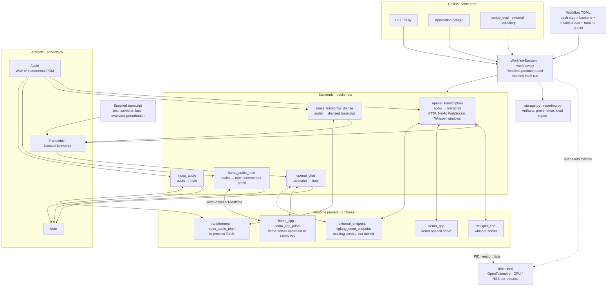

# Scribnic

Scribnic is a local clinical scribe core. The CLI, applications, and evaluation
tools share the same Python API. A **workflow** declares how to produce a clinical
note from audio or from a transcript. The bundled templates write Spanish SOAP notes.

Every model family plugs in the same way: a workflow step selects a **backend**,
a **model preset**, and a **runtime preset**. Whisper, NVIDIA NeMo, Bonsai, Qwen,
LFM3, and MOSS are all just combinations of those three pieces.

## Concepts

| Piece | Responsibility | Lives in |
| --- | --- | --- |
| Workflow | Selects steps and the default output (`note`) | `presets/workflows/*.toml` |
| Model preset | Identifies weights: repository, revision, file, SHA256, format/quantization, accepted inputs and output | `presets/models/*.toml` |
| Runtime preset | Selects an engine and its pinned distribution, plus engine settings | `presets/runtimes/*.toml` |
| Runtime manager | Installs or locates the engine, starts the process, waits for readiness, and stops it | `runtimes/` |
| Backend | Adapts an inference protocol to Scribnic artifacts: builds requests and converts responses | `backends/` |
| Artifact | Passive data that can be saved and reused as input: `AudioFile`, `Transcript`, `DiarizedTranscript`, `Note` | `artifacts.py` |

Sharing HTTP does not mean sharing formats or capabilities: diarization,
timestamps, and streaming are declared per model and backend. The lifecycle is
`setup → start → run → close`: prepare files on disk, load the selected steps,
reuse them across requests, and release the processes Scribnic owns. Artifacts
from one recording never become state for another.

## Architecture



Runtime managers start, check, and stop only processes that Scribnic owns. An
external endpoint is never downloaded or terminated by the client. A clinician's
installation contains only the dependencies, weights, and engines of its workflow;
code for other providers stays importable without loading their libraries.
Datasets, judges, perturbations, and quality metrics belong to `scribe_eval`.

## Install and run

Requires Python 3.12–3.14 and [uv](https://docs.astral.sh/uv/).

```bash
uv sync --locked
uv run scribnic setup --workflow nvidia_cpp_offline
uv run scribnic run consultation.wav --workflow nvidia_cpp_offline
```

`setup` downloads and verifies only the workflow's resources without loading
models. Native runtimes (NeMo-Speech.cpp, llama-server, Prism) come from pinned
releases with SHA256. whisper.cpp v1.9.5 is built from pinned source; it needs a
C/C++ compiler and either CMake or `uvx`, which fetches CMake 4.1.0 into an
isolated tool environment. The C++ workflows need no Torch, Transformers, or
llama.cpp Python bindings.

Input WAV files must be PCM16, mono, 16 kHz:

```bash
ffmpeg -i input.mp3 -ac 1 -ar 16000 -c:a pcm_s16le consultation.wav
```

Each run prints the path to `report.html`, which shows the note, transcript,
timings, effective configuration, provenance, and per-process resources. The
audio stays at its original path.

To install a client from a wheel, use `pip install scribnic-0.1.0-py3-none-any.whl`;
the `dev` group is not installed. In a checkout, `uv sync --no-dev` excludes
development tools.

## Workflows by backend and runtime

Speech workflows generate notes with Bonsai 2 2B PQ2_0 on the Prism llama-server
unless their name says otherwise. Swap the `note` step to try another generator.

| Backend | Runtime preset · engine | Models | Workflows | Extra |
| --- | --- | --- | --- | --- |
| `openai_transcription` | `whisper_cpp` · whisper-server | Whisper tiny, base, small, medium, large-v3-turbo Q8_0; large-v3 Q5_0 | `whisper_bonsai`, `whisper_bonsai_vad`, `whisper_bonsai_streaming`, `whisper_<size>_<quant>_bonsai`, `whisper_qwen35_08b_q8_0` | — |
| `openai_transcription` | `nemo_cpp` · nemo-speech | Nemotron 3.5 ASR Q8_0, optional Nemotron 3 Diarization Q8_0 | `nvidia_cpp_offline`, `nvidia_cpp_streaming`, `nvidia_cpp_asr_offline`, `nvidia_cpp_asr_streaming` | `[streaming]` for streaming |
| `openai_transcription` | `nemo_cpp` · nemo-speech | Parakeet TDT 0.6B v3 Q8_0, optional diarizer | `parakeet_v3_q8_0_bonsai`, `parakeet_v3_q8_0_diarized_bonsai` | — |
| `openai_transcription` | `sglang_omni_endpoint` · external | MOSS-Transcribe-Diarize | `moss_bonsai_sglang` | — |
| `moss_transcribe_diarize` | `transformers` · in-process Torch | MOSS-Transcribe-Diarize BF16 | `moss_bonsai`, `moss_bonsai_http` (note on an external endpoint) | `[moss]` |
| `openai_chat` | `llama_cpp_prism` · llama-server Prism | Bonsai 2 2B / 4B PQ2_0 | `bonsai_note`, `bonsai_4b_note` | — |
| `openai_chat` | `llama_cpp` · llama-server b11946 | Qwen3.5 0.8B / 2B / 4B, LFM3-1.7B | `qwen35_*_note`, `lfm3_17b_*_note` | — |
| `llama_audio_note` | `llama_cpp` · llama-server b11946 | LFM3-Audio-2B Q4_K_M + mmproj Q8_0 | `lfm3_audio_note` | `[streaming]` |
| `moss_audio` | `moss_audio_torch` · in-process Torch | MOSS-Audio-4B-Thinking BF16 | `moss_audio_note` | `[moss-audio]` |

Text workflows (`*_note`) accept plain text or a saved transcript and run only the
note step. `setup` prepares weights and engines; it never installs Python packages.
`[moss]` and `[moss-audio]` pin incompatible Transformers versions, so use separate
environments for them; `--all-extras` is not valid.

```bash
# NVIDIA streaming adds only the small WebSocket client.
uv run --extra streaming scribnic run consultation.wav --workflow nvidia_cpp_streaming

# Whisper windows over HTTP, replaying the WAV at real-time pace.
uv run scribnic run consultation.wav --workflow whisper_bonsai_streaming --realtime

# Note directly from audio with LFM3; no transcript and no Torch.
uv run --extra streaming scribnic run consultation.wav --workflow lfm3_audio_note

# MOSS through an existing SGLang Omni service.
SCRIBNIC_MOSS_BASE_URL=http://127.0.0.1:8000/v1 \
  uv run scribnic run consultation.wav --workflow moss_bonsai_sglang
```

Validated on WSL/Linux x86_64 CPU. macOS and Windows assets are configured but
need testing on those hosts. The MOSS full checkpoints and SGLang service have not
been run here. Clinical quality is still being evaluated for every workflow.

## Python API

```python
from scribnic import AudioFile, Transcript, open_workflow

with open_workflow("nvidia_cpp_offline") as scribe:
    startup = scribe.start()  # Optional: preload before timing requests.
    result = scribe.run(AudioFile("consultation.wav"), output_dir="runs/consultation")
    print(result.note.text)

    speech = scribe.run(AudioFile("other.wav"), output="diarized_transcript")
    plain = speech.transcript.without_speakers()
    ablation = scribe.run(plain)  # Note step only, on the supplied text.
    manual = scribe.run(Transcript.from_text("Paciente: tengo tos desde ayer."))
```

Models stay loaded for the session; every recording gets fresh recognition state
and artifacts. `run_stream` accepts incremental PCM from any source. See
[Python API and sessions](docs/python_api.md) for preloading, residency, and
parallel evaluation, and [incremental audio](docs/streaming.md) for streaming.

## CLI and configuration

```bash
# Stop at the speech artifact.
uv run scribnic run consultation.wav --workflow nvidia_cpp_offline \
  --output diarized_transcript --output-dir runs/speech

# Generate a note from a saved artifact, without audio recognition.
uv run scribnic run runs/speech/diarized_transcript.json --workflow bonsai_note

# One JSON document on stdout; progress on stderr.
uv run scribnic run conversation.txt --workflow bonsai_note --format json

uv run scribnic --install-completion
```

Progress and warnings go to `stderr`. Redirected output prints stable phase lines
without animation; `NO_COLOR` disables colors. `--verbose` shows Scribnic
diagnostics. `Ctrl+C` closes the session and owned servers, exits with code 130,
and keeps artifacts already saved. `--offline` requires cached resources but still
calls the selected endpoint. `--profile` adds detailed profiling where the engine
supports it. Importing the Python API does not import Typer, Rich, or Torch.

A step selects its backend, model, and runtime explicitly:

```toml
name = "consultation"
default_output = "note"

[steps.speech]
backend = "openai_transcription"
model = "nemotron-3.5-asr-streaming-0.6b.q8_0"
runtime = "nemo_cpp"
output = "diarized_transcript"

[steps.speech.companions]
diarization = "Nemotron-3-Diarization.q8_0"

[steps.note]
backend = "openai_chat"
model = "Ternary-Bonsai-2-2B-PQ2_0"
runtime = "llama_cpp_prism"
template = "soap_es"
source = "speech"

[steps.note.model_settings]
temperature = 0.0
```

The model preset declares inputs, outputs, and response format; the workflow can
override settings and request a compatible output. The resolver reports missing
producers, ambiguity, and cycles before preparing models. Workflow selection is an
explicit file, a `default.toml`, or the only workflow in a directory. Sampling,
templates, devices, and threads are configured in TOML. The `external_endpoint`
preset reads `SCRIBNIC_BASE_URL` and `SCRIBNIC_API_KEY`.

Inputs over the configured limit are rejected rather than truncated, and an
incomplete note or one containing thinking tags is not accepted.

## Outputs and observability

Each run saves the artifacts it produced, `result.json`, `run.json`, `report.html`,
`runtime/*` diagnostics, and OTLP telemetry in `telemetry/*.jsonl`. Each step is
persisted before the next starts; a failure exposes the partial result through
`WorkflowRunError.result`. Existing results are never overwritten.

CPU and RSS are sampled for Python and for every owned process (`nemo-speech`,
`whisper-server`, `llama-server`). The JSON also records the peak of the per-sample
RSS sum. That sum may count shared pages more than once and is neither physical
RAM nor VRAM. Torch backends can export compressed operator traces for Perfetto;
native servers keep logs and provenance. Run latency benchmarks without `--profile`.

The library uses OpenTelemetry APIs; the application or harness configures the SDK
and exporters. `scribnic.telemetry.Telemetry` offers optional local export without
replacing the host process's global provider.

## Development

```bash
uv sync --locked --extra moss --extra streaming
uv run ruff check src tests
uv run ruff format --check src tests
uv run ruff check src/scribnic/telemetry --extend-select D,ANN
uv run python -m unittest discover -s tests -v
```

Ordinary tests use fakes; they do not download models or contact inference
services. The live MOSS test runs with `SCRIBNIC_LIVE_TESTS=1` and
`SCRIBNIC_TEST_AUDIO`. Design, documentation, and style rules are in
[AGENTS.md](AGENTS.md).

## Documentation

| Document | Contents |
| --- | --- |
| [Python API and sessions](docs/python_api.md) | Lifecycle, preloading, residency, parallel evaluation |
| [Incremental audio](docs/streaming.md) | `run_stream`, Whisper windows, NVIDIA WebSocket, measurement |
| [NVIDIA NeMo](docs/nvidia.md) | nemo-speech server, offline and streaming modes, diarization strategy |
| [Speech presets](docs/asr_presets.md) | Whisper sizes and Parakeet v3 presets and how to compare them |
| [Note models](docs/note_models.md) | Text note generators, quantizations, sampling profiles |
| [LFM3-Audio](docs/lfm3.md) | Direct audio-to-note with incremental prefill |
| [MOSS](docs/moss.md) | MOSS-Transcribe-Diarize and MOSS-Audio presets |
| [Model sources](docs/model_sources.md) | Weight provenance policy and publisher notes |
| [Speech candidates](docs/asr_models.md) | Research on future ASR and audio-to-note models |
| [Hardware selection](docs/hardware_selection.md) | Unimplemented proposal for device and dtype selection |
| [Text note evaluation](docs/text_note_evaluation.md) | LFM3 text vs Bonsai 4B comparison, 2026-10-28 |
