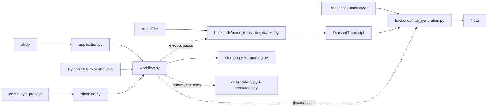

# Scribnic

Núcleo local de escriba clínico: un workflow declara cómo llegar de una entrada a
una nota. La misma API sirve para Python, CLI y un futuro evaluador o servidor.
Actualmente incluye MOSS-Transcribe-Diarize, Bonsai mediante HTTP y una demo sin
modelos. NeMo, Nemotron, Qwen-ASR y VibeVoice se han retirado.

## Instalar y ejecutar

Python 3.12 o posterior y [uv](https://docs.astral.sh/uv/). Desde este repositorio:

```bash
uv sync --locked --extra moss
uv run --extra moss scribnic prepare --workflow moss_bonsai
uv run --extra moss scribnic run consulta.wav --workflow moss_bonsai
```

Abre el `report.html` de la ruta impresa. Es un HTML local con nota, transcripción,
audio, tiempos, consumo de recursos y configuración efectiva. El audio se enlaza
en su ubicación original; no se copia dentro del informe.

`prepare` comprueba la caché y descarga lo que falta. No carga pesos en memoria.
`run` genera una nota por defecto. MOSS produce directamente la transcripción
con hablantes; Bonsai recibe esa conversación y genera SOAP breve en español,
en texto libre. Los prompts permiten interpretar quién habla como médico o
paciente por el contenido; el número del hablante no determina su rol.

Los modelos y binarios tienen revisiones fijadas. El workflow local descarga
Bonsai PQ2_0 y el `llama-server` compatible del fork de Prism, verifica sus hashes,
lo inicia en loopback y lo cierra al salir. No requiere LM Studio ni bindings
Python de llama.cpp. MOSS usa el checkpoint de Hugging Face, incluido su código
Python fijado por revisión (`trust_remote_code=True`).

La instalación base evita Torch y Transformers:

```bash
uv sync --locked
uv run scribnic run conversacion.txt --workflow demo
uv run scribnic run conversacion.txt --workflow bonsai_note
```

`demo` produce salidas **inventadas**, identificadas en terminal e informe.
`bonsai_note` ejecuta Bonsai real sin instalar MOSS. Para instalar un wheel como
cliente: `pip install scribnic-0.1.0-py3-none-any.whl`, o añade `[moss]` para voz.
Ruff está en el grupo de desarrollo; `uv sync --no-dev` lo excluye.

El WAV debe ser PCM16, mono, 16 kHz. Si necesitas convertirlo:

```bash
ffmpeg -i entrada.mp3 -ac 1 -ar 16000 -c:a pcm_s16le consulta.wav
```

## Workflows y CLI

| Workflow | Voz | Nota |
| --- | --- | --- |
| `moss_bonsai` | MOSS / Transformers | Bonsai / llama-server gestionado |
| `moss_bonsai_http` | MOSS / Transformers | Bonsai / endpoint existente |
| `bonsai_note` | Entrada de texto | Bonsai / llama-server gestionado |
| `demo` | Salidas inventadas | Salida inventada |

Para tu LM Studio en Windows:

```bash
export SCRIBNIC_BASE_URL=http://localhost:1235/v1
uv run --extra moss scribnic run consulta.wav --workflow moss_bonsai_http
```

El ID esperado es `ternary-bonsai-2-2b`. Se puede cambiar mediante
`model_settings.served_model` en el workflow. El endpoint también acepta
`SCRIBNIC_API_KEY`. En WSL con NAT puede hacer falta la IP de Windows y habilitar
el acceso de red en LM Studio.

```bash
# Parar antes de generar la nota.
uv run --extra moss scribnic run consulta.wav --workflow moss_bonsai \
  --output diarized_transcript --output-dir runs/solo-voz

# Reutilizar una transcripción guardada, sin ejecutar MOSS.
uv run scribnic run runs/solo-voz/diarized_transcript.json \
  --workflow bonsai_note --output-dir runs/solo-nota

# Un único documento JSON en stdout; progreso y diagnóstico en stderr.
uv run scribnic run conversacion.txt --workflow bonsai_note --format json
```

Las otras opciones de `run` son `--offline` (ninguna descarga de recursos) y
`--profile` (traza detallada de Torch además de telemetría normal). Los modelos,
dispositivos, prompts, límites y sampling se configuran en TOML.
`--offline` permite llamar a un endpoint HTTP configurado; no es un bloqueo de red.

El progreso normal de MOSS muestra la carga, el dispositivo efectivo, la precisión,
los hilos de CPU y las versiones del runtime. Después informa del encoder/prefill
y publica el número de tokens generados aproximadamente cada cinco segundos,
también en los logs OTLP. Esto funciona sin `--profile`. El contador indica trabajo
real, no un porcentaje de audio procesado; la nota empieza cuando termina MOSS.

Puedes seleccionar un preset, archivo o carpeta con `--workflow`. Una carpeta
usa `default.toml` o su único TOML; si hay varios, exige elegir uno.
Un workflow personalizado puede reutilizar presets y sobrescribir ajustes:

```toml
name = "mi_consulta"
inputs = ["audio", "transcript", "diarized_transcript"]
default_output = "note"

[steps.speech]
model = "moss_transcribe_diarize"
runtime = "transformers"

[steps.speech.runtime_settings]
device = "cpu"

[steps.note]
model = "bonsai_2_2b"
runtime = "llama_cpp"
template = "soap_es" # También puede ser un archivo Markdown relativo al workflow.
source = "speech"

[steps.note.model_settings]
max_tokens = 768
temperature = 0.7
```

Cada paso declara, mediante su preset de modelo, las entradas que acepta y una
salida. El resolver sigue los productores configurados, detecta ciclos y
ambigüedades y respeta una entrada ya suministrada. Cada paso consume un artefacto;
no hay un motor genérico de tareas paralelas o combinaciones de múltiples entradas.
MOSS declara `audio → diarized_transcript`; no se crea otro transcript por debajo.

El preset de Bonsai conserva el [perfil publicado para modelos pequeños de Prism](https://github.com/PrismML-Eng/Bonsai-demo/blob/main/SMALL-MODELS.md):
`temperature=0.7`, `top_p=0.8`, `top_k=20`, `min_p=0`,
`presence_penalty=1.5`, repetición `1.0`/ventana `64`, thinking desactivado.
El contexto de llama-server es 8192. El límite preventivo de 12000 caracteres
no mide tokens; las entradas largas se rechazan sin truncar. No hay resumen por
fragmentos todavía. Una salida cortada por límite de tokens tampoco se acepta.

## API Python y futuros evals

```python
from scribnic import AudioFile, Transcript, open_workflow, save_artifact

with open_workflow("moss_bonsai") as scribe:
    result = scribe.run(AudioFile("consulta.wav"))
    print(result.note.text)

    speech = scribe.run(AudioFile("consulta.wav"), output="diarized_transcript")
    modified = speech.transcript.without_speakers()
    save_artifact(modified, "sin_hablantes.json")
    ablation = scribe.run(modified)

    manual = scribe.run(Transcript.from_text("Paciente: me duele la cabeza."))
```

Una sesión conserva modelos cargados, pero cada ejecución tiene sus propios
artefactos. `without_speakers()` elimina etiquetas y roles conservando texto,
turnos y tiempos; no cambia el original. También puedes construir nuevos
`TextSegment`/`SpeakerSegment` desde fuera para perturbaciones. Los tiempos y roles
pueden ser desconocidos: no se inventan. Las etiquetas identifican voces y son
independientes de los roles clínicos opcionales.

`open_workflow` prepara los recursos del workflow completo por defecto.
`prepare=False` permite preparar únicamente los pasos que llegue a usar `run`;
los modelos se cargan en memoria al ejecutarlos. `download=False` exige caché.
Cada sesión serializa sus llamadas a `run`; un harness puede administrar sus
propios procesos/sesiones según los recursos disponibles.

```python
from scribnic import load_artifact, open_workflow
from scribnic.observability import Telemetry

with Telemetry("runs/python/telemetry"):
    with open_workflow("bonsai_note") as scribe:
        result = scribe.run(
            load_artifact("sin_hablantes.json"), output_dir="runs/python"
        )
```

La biblioteca no configura el SDK global de la aplicación que la incorpora.
`Telemetry` es un contexto opcional de exportación local. También se puede usar
el proveedor OpenTelemetry configurado por el servidor/harness. El adaptador de
alto nivel `scribnic.application.execute` configura persistencia y exportación
local igual que la CLI; la lógica de inferencia vive en `WorkflowSession`.

`load_artifact` admite JSON versionado de Scribnic, texto plano y transcripciones
con `segments` al estilo OpenAI (`speaker`, `start`, `end`, `text`), además de los
antiguos `utterances`. El harness futuro `scribe_eval` podrá pasar estos artefactos,
guardar predicciones y puntuarlas por separado; datasets, perturbaciones y jueces
no forman parte de este núcleo.

## Resultados y observabilidad

Cada etapa se guarda antes de empezar la siguiente. Si falla, se lanza
`WorkflowRunError` con `.result` parcial; los archivos guardados indican `error`.
Si se interrumpe Python se intenta guardar `interrupted`. Tras una terminación
externa abrupta, el último checkpoint puede seguir indicando `running`.

| Archivo | Contenido |
| --- | --- |
| `audio.json`, `diarized_transcript.json`, `transcript.json` | Solo los artefactos realmente disponibles, con tipo y versión. |
| `note.json`, `note.txt` | Nota terminada. |
| `result.json` | Resultado completo o parcial, configuración, procedencia y métricas. |
| `run.json` | Metadatos sin repetir la lista de artefactos. |
| `report.html` | Vista local, sin servidor ni recursos web externos. |
| `telemetry/*.jsonl` | Trazas, métricas y logs en formato OTLP JSONL real. |
| `note-metrics.prom` | Métricas nativas de llama-server, cuando están disponibles. |
| `profiles/moss-profile.json` | Resumen agregado por operador y fase, y lista de bloques. |
| `profiles/moss-trace-*.json.gz` | Captura continua de operadores en bloques comprimidos para Perfetto. |

Se muestrean RSS, tiempo de CPU y cores equivalentes de Scribnic y los runtimes
locales que posee. Se conserva el pico de memoria asignada/reservada por Torch en
CUDA/ROCm y los tiempos nativos de prefill/decode de llama-server. El RSS no equivale
a memoria GPU; los picos muestreados pueden omitir transitorios. Los procesos
remotos necesitan instrumentación propia. Estas medidas describen una ejecución,
no bastan por sí solas para fijar requisitos mínimos de un PC.

`--profile` es para investigación y añade overhead. Etiqueta frontend, encoder,
adaptor, prefill y decode de MOSS; por defecto captura operadores de CPU. Para
solicitar también actividad GPU usa `profile_gpu = true` en
`steps.speech.runtime_settings`. En MPS emite signposts para Instruments; no promete
una línea temporal de kernels Metal en la traza JSON. Empieza con audio corto:
las trazas detalladas pueden consumir mucha memoria y disco. La captura se exporta
cada 16 pasos del decoder, sin omitir pasos, para no retener toda la consulta en
RAM. Los picos del encoder/prefill siguen dependiendo del audio; esto no fija un
límite de RAM. `profile_window_steps` permite ajustar el tamaño de bloque. Se guardan
formas de entrada, asignaciones de tensores y tiempos por operador; el resumen y
los operadores más costosos aparecen también en `report.html`. La memoria neta
por operador es un balance de asignaciones, no un pico de RAM o VRAM.

Para perfilar `dialogue8` completo, elige un directorio nuevo:

```bash
uv run --extra moss scribnic run ./data/examples/dialogue8.wav \
  --workflow moss_bonsai --profile --output-dir runs/dialogue8-full-profile
```

Esto incluye el encoder, el prefill y todos los pasos de decode de MOSS. Abre los
bloques `.json.gz` en Perfetto y consulta `moss-profile.json` para los totales de
toda la ejecución. Compara tiempos de rendimiento con una ejecución sin profiler:
la instrumentación, la agregación y la compresión pueden multiplicar el tiempo.
El profiler de Torch no ve los
operadores del proceso llama-server, que conserva sus propias métricas y log.

## Plataformas y validación

El lock usa Torch CPU en Linux/Windows y el wheel habitual en macOS. No instala
ROCm ni CUDA como parte de la instalación portable. Para un entorno GPU preparado,
instala Scribnic y las dependencias compatibles sin sustituir el Torch específico
de ese entorno; evita `uv sync` sobre una `.venv` de aceleración personalizada.

Si la terminal muestra `Torch ...+cpu`, `device = "auto"` ejecuta MOSS en CPU
aunque el PC tenga una GPU AMD/NVIDIA. Un WAV de cinco minutos puede tardar bastante
más que la duración del audio. El preset limita MOSS a seis hilos durante inferencia
en CPU (`threads` en el runtime Transformers); el valor anterior se restaura al salir.
Cambiar solamente `device` no instala el runtime de aceleración que falta.

MOSS selecciona CUDA/ROCm si el Torch instalado lo detecta y CPU en los demás
casos. MPS requiere selección explícita (`device = "mps"`) y no se ha validado.
En una Mac Studio, Bonsai elige el binario arm64/Metal; MOSS empieza en CPU.
En Windows se empaqueta el servidor CPU x64. Los hashes y rutas de los archivos
de Mac/Windows se comprobaron; la inferencia en esas plataformas queda pendiente.

En el stack AMD/WSL local apareció `miopenStatusUnknownError` en las convoluciones
de Whisper. Existe el ajuste explícito `cudnn_enabled = false` para usar las
convoluciones nativas durante la generación y restaurar después el estado de
PyTorch. El intento GPU con profiling quedó incompleto tras reiniciarse WSL;
no se considera validado. CPU es la ruta de referencia de este refactor.

## Navegar y desarrollar

Validación real del refactor (20 de octubre de 2026): un WAV de 35 s completó
MOSS → Bonsai en CPU en 108,68 s, con 13 segmentos y dos hablantes. Voz: 100,40 s;
nota: 4,61 s. Picos RSS muestreados por separado: 5,18 GiB en Python y 1,25 GiB en
llama-server. La reutilización de una transcripción guardada sin hablantes ejecutó
solo la nota. Los informes locales y las versiones verificadas están registrados
en [REFACTOR_PLAN.md](REFACTOR_PLAN.md). Se observaron errores de transcripción,
contenido mal ubicado en SOAP e inferencias y repeticiones de Bonsai; esta prueba
confirma ejecución, no calidad clínica.

```text
src/scribnic/
  artifacts.py                Datos pasivos: audio, texto, hablantes, nota, resultado
  config.py / planning.py     Cargar configuración y resolver productores
  workflow.py                 Sesión, ejecución y propiedad de los backends
  audio.py / notes.py          Validar WAV y formatear la entrada de la nota
  downloads.py / runtimes.py   Caché versionada y ciclo de vida de llama-server
  backends/                   MOSS, generación HTTP y demo
  observability.py             SDK/exportadores locales opcionales
  resources.py / profiling.py  Muestreo de procesos y trazas detalladas
  storage.py / reporting.py    Checkpoints JSON, terminal e informe HTML
  application.py / cli.py      Aplicación de archivos y adaptador de argumentos
  presets/                    Modelos, runtimes, workflows y templates
  assets/                     HTML y CSS del informe
```



```bash
uv run ruff check src tests
uv run ruff format --check src tests
uv run python -m unittest discover -s tests -v
uv build
```

Los tests normales usan fakes, sin red, pesos o GPU. Con el extra MOSS también se
comprueba el profiler en un módulo diminuto de CPU. El test end-to-end real es
opt-in: `SCRIBNIC_LIVE_TESTS=1`, `SCRIBNIC_TEST_AUDIO=/ruta/consulta.wav` y todos los
recursos ya preparados. Las convenciones de código están en [AGENTS.md](AGENTS.md)
y el seguimiento del refactor en [REFACTOR_PLAN.md](REFACTOR_PLAN.md).
