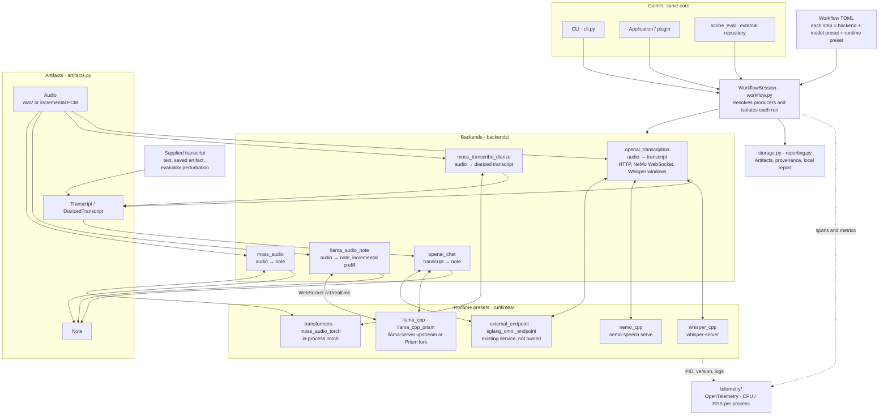

# Scribnic

Scribnic is a local clinical scribe core. The CLI, applications, and evaluation
tools share the same Python API. A **workflow** declares how to produce a clinical
note from audio or from a transcript. The bundled templates write Spanish SOAP notes.

> [!WARNING]
> Scribnic is research software, not a medical device. Generated transcripts and
> notes can be incomplete or wrong. It is not validated for clinical use; a
> qualified professional must review every note, and deployments must follow the
> applicable health data and medical device regulations.

Every model family plugs in the same way: a workflow step selects a **backend**,
a **model preset**, and a **runtime preset**. Whisper, NVIDIA NeMo, Bonsai, Qwen,
LFM3, and MOSS are all just combinations of those three pieces.

## Concepts

| Piece | Responsibility | Lives in |
| --- | --- | --- |
| Workflow | Selects steps and the default output (`note`) | `presets/workflows/*.toml` |
| Model preset | Identifies weights: repository, revision, file, SHA256, format/quantization, accepted inputs and output | `presets/models/<role>/<family>/*.toml` |
| Runtime preset | Selects an engine and its pinned distribution, plus engine settings | `presets/runtimes/*.toml` |
| Runtime manager | Installs or locates the engine, starts the process, waits for readiness, and stops it | `runtimes/` |
| Backend | Adapts an inference protocol to Scribnic artifacts: builds requests and converts responses | `backends/` |
| Artifact | Passive data that can be saved and reused as input: `AudioFile`, `Transcript`, `DiarizedTranscript`, `Note` | `artifacts.py` |

Sharing HTTP does not mean sharing formats or capabilities: diarization,
timestamps, and streaming are declared per model and backend. The lifecycle is
`setup → start → run → close`: prepare files on disk, load the selected steps,
reuse them across requests, and release the processes Scribnic owns. Artifacts
from one recording never become state for another.

## Architecture



Runtime managers start, check, and stop only processes that Scribnic owns. An
external endpoint is never downloaded or terminated by the client. A clinician's
installation contains only the dependencies, weights, and engines of its workflow;
code for other providers stays importable without loading their libraries.
Datasets, judges, perturbations, and quality metrics belong to `scribe_eval`.

## Install and run

Requires Python 3.12–3.14 and [uv](https://docs.astral.sh/uv/).

```bash
uv sync --locked

# Note from text: only llama-server and a small note model, no audio models.
echo "Paciente: tengo tos desde hace tres días." > conversation.txt
uv run scribnic run conversation.txt --workflow bonsai_note

# Audio to note: Whisper small on whisper.cpp, then Bonsai 2 2B.
uv run scribnic setup --workflow whisper_bonsai
uv run scribnic run consultation.wav --workflow whisper_bonsai
```

`whisper_bonsai` is the most exercised audio workflow; scribe_eval uses the same
pairing. Other workflows are listed under [Models and workflows](#models-and-workflows).

`setup` downloads and verifies only the workflow's resources without loading
models. Native runtimes (NeMo-Speech.cpp, llama-server, Prism) come from pinned
releases with SHA256. whisper.cpp v1.9.5 is built from pinned source; it needs a
C/C++ compiler and either CMake or `uvx`, which fetches CMake 4.1.0 into an
isolated tool environment. The C++ workflows need no Torch, Transformers, or
llama.cpp Python bindings.

Input WAV files must be PCM16, mono, 16 kHz:

```bash
ffmpeg -i input.mp3 -ac 1 -ar 16000 -c:a pcm_s16le consultation.wav
```

Each run prints the path to `report.html`, which shows the note, transcript,
timings, effective configuration, provenance, and per-process resources. The
audio stays at its original path.

To install a client from a wheel, use `pip install scribnic-0.1.0-py3-none-any.whl`;
the `dev` group is not installed. In a checkout, `uv sync --no-dev` excludes
development tools.

## Models and workflows

Model presets are grouped by role and then by family under `presets/models/`.
Workflows refer to presets by name, so the folders only organize them. A speech
workflow pairs a speech model with a note model; the bundled ones use Bonsai 2 2B
unless their name says otherwise (`whisper_qwen35_08b_q8_0`). Any note model works
after any speech model: change the `note` step's `model` and `runtime`.

**Speech** (`speech/`): audio → transcript or diarized transcript.

| Family | Presets | Runtime · engine | Workflows | Extra |
| --- | --- | --- | --- | --- |
| Whisper (`whisper/`) | tiny, base, small, medium, large-v3-turbo Q8_0; large-v3 Q5_0 | `whisper_cpp` · whisper-server | `whisper_bonsai` (small), `whisper_bonsai_vad`, `whisper_bonsai_streaming`, `whisper_<size>_<quant>_bonsai`, `whisper_qwen35_08b_q8_0` | — |
| NVIDIA (`nvidia/`) | Nemotron 3.5 ASR streaming 0.6B Q8_0, Parakeet TDT 0.6B v3 Q8_0, optional Nemotron 3 Diarization Q8_0 | `nemo_cpp` · nemo-speech | `nvidia_cpp_offline`, `nvidia_cpp_streaming`, `nvidia_cpp_asr_offline`, `nvidia_cpp_asr_streaming`, `parakeet_v3_q8_0_bonsai`, `parakeet_v3_q8_0_diarized_bonsai` | `[streaming]` for streaming |
| MOSS (`moss/`) | MOSS-Transcribe-Diarize BF16 | `transformers` · in-process Torch; `sglang_omni_endpoint` · external | `moss_bonsai`, `moss_bonsai_http` (note on an external endpoint), `moss_bonsai_sglang` | `[moss]` in process |

**Note** (`note/`): plain or diarized transcript → note. Text workflows (`*_note`)
accept plain text or a saved transcript and run only this step.

| Family | Presets | Runtime · engine | Workflows |
| --- | --- | --- | --- |
| Bonsai 2 (`bonsai/`) | 2B, 4B PQ2_0 | `llama_cpp_prism` · llama-server Prism fork | `bonsai_note`, `bonsai_4b_note` |
| Qwen3.5 (`qwen/`) | 0.8B, 2B, 4B Q4_K_M / Q8_0 | `llama_cpp` · llama-server b11946 | `qwen35_<size>_<quant>_note` |
| LFM3 (`lfm/`) | 1.7B Q4_K_M, Q8_0, QAD Q4_0 | `llama_cpp` · llama-server b11946 | `lfm3_17b_<quant>_note` |

**Audio to note** (`audio_note/`): audio → note without a transcript.

| Family | Presets | Runtime · engine | Workflows | Extra |
| --- | --- | --- | --- | --- |
| LFM3-Audio (`lfm/`) | 2B Q4_K_M + mmproj Q8_0 | `llama_cpp` · llama-server b11946 | `lfm3_audio_note` | `[streaming]` |
| MOSS-Audio (`moss/`) | 4B-Thinking BF16 | `moss_audio_torch` · in-process Torch | `moss_audio_note` | `[moss-audio]` |

`setup` prepares weights and engines; it never installs Python packages. `[moss]`
and `[moss-audio]` pin incompatible Transformers versions, so use separate
environments for them; `--all-extras` is not valid. Comparisons are in
[note models](docs/note_models.md) and [speech presets](docs/asr_presets.md).

### How a model gets a preset

- **Source:** weights from the model author's organization, or a conversion by an
  identified organization. No personal accounts, with one documented exception:
  the official whisper.cpp repository.
- **Reproducible:** pinned repository, revision, file, and SHA256, and the preset
  names the real weight format and quantization.
- **Local runtime:** it runs on an engine Scribnic manages (whisper.cpp,
  llama.cpp, NeMo-Speech.cpp) or in process behind an optional extra, so the base
  installation stays small.
- **Not a quality claim:** a preset makes a run reproducible. Validated platforms
  are stated separately, and clinical quality is measured with scribe_eval.

The full policy and catalog are in [model sources](docs/model_sources.md). To
propose a model, open a feature request with its source, format, and license.

```bash
# NVIDIA streaming adds only the small WebSocket client.
uv run --extra streaming scribnic run consultation.wav --workflow nvidia_cpp_streaming

# Whisper windows over HTTP, replaying the WAV at real-time pace.
uv run scribnic run consultation.wav --workflow whisper_bonsai_streaming --realtime

# Note directly from audio with LFM3; no transcript and no Torch.
uv run --extra streaming scribnic run consultation.wav --workflow lfm3_audio_note

# MOSS through an existing SGLang Omni service.
SCRIBNIC_MOSS_BASE_URL=http://127.0.0.1:8000/v1 \
  uv run scribnic run consultation.wav --workflow moss_bonsai_sglang
```

## Tested on

| Platform | Hardware | What ran |
| --- | --- | --- |
| macOS 15.6, Apple Silicon | Mac Studio, M3 Ultra, 512 GB | Full PriMock57 run through scribe_eval: Whisper small Q8_0 on whisper.cpp with Metal, then Bonsai 2 2B PQ2_0 on the Prism llama-server |
| Linux x86_64 (WSL2), CPU only | 11 GiB memory | The bundled workflows, except the full MOSS checkpoints and the SGLang service |
| Linux, macOS, Windows (CI) | GitHub-hosted runners | Unit tests with fakes, Python 3.12 and 3.14 |

Windows assets are configured but have had no full run. On the Mac, llama-server
sees the Metal device, but Scribnic does not yet log where it offloads layers
([#39](https://github.com/eljoserass/scribnic/issues/39)). Clinical quality is
still being evaluated for every workflow.

## Python API

```python
from scribnic import AudioFile, Transcript, open_workflow

with open_workflow("whisper_bonsai") as scribe:
    startup = scribe.start()  # Optional: preload before timing requests.
    result = scribe.run(AudioFile("consultation.wav"), output_dir="runs/consultation")
    print(result.note.text)

    speech = scribe.run(AudioFile("other.wav"), output="transcript")
    again = scribe.run(speech.transcript)  # Note step only, on the supplied text.
    manual = scribe.run(Transcript.from_text("Paciente: tengo tos desde ayer."))
```

Models stay loaded for the session; every recording gets fresh recognition state
and artifacts. `run_stream` accepts incremental PCM from any source. See
[Python API and sessions](docs/python_api.md) for preloading, residency, and
parallel evaluation, and [incremental audio](docs/streaming.md) for streaming.

## CLI and configuration

```bash
# Stop at the speech artifact.
uv run scribnic run consultation.wav --workflow whisper_bonsai \
  --output transcript --output-dir runs/speech

# Generate a note from a saved artifact, without audio recognition.
uv run scribnic run runs/speech/transcript.json --workflow bonsai_note

# One JSON document on stdout; progress on stderr.
uv run scribnic run conversation.txt --workflow bonsai_note --format json

uv run scribnic --install-completion
```

Progress and warnings go to `stderr`. Redirected output prints stable phase lines
without animation; `NO_COLOR` disables colors. `--verbose` shows Scribnic
diagnostics. `Ctrl+C` closes the session and owned servers, exits with code 130,
and keeps artifacts already saved. `--offline` requires cached resources but still
calls the selected endpoint. `--profile` adds detailed profiling where the engine
supports it. Importing the Python API does not import Typer, Rich, or Torch.

A step selects its backend, model, and runtime explicitly:

```toml
name = "consultation"
default_output = "note"

[steps.speech]
backend = "openai_transcription"
model = "whisper_small_q8_0"
runtime = "whisper_cpp"

[steps.note]
backend = "openai_chat"
model = "Ternary-Bonsai-2-2B-PQ2_0"
runtime = "llama_cpp_prism"
template = "soap_es"
source = "speech"

[steps.note.model_settings]
temperature = 0.0
```

The model preset declares inputs, outputs, and response format; the workflow can
override settings and request a compatible output. The resolver reports missing
producers, ambiguity, and cycles before preparing models. Workflow selection is an
explicit file, a `default.toml`, or the only workflow in a directory. Sampling,
templates, devices, and threads are configured in TOML. The `external_endpoint`
preset reads `SCRIBNIC_BASE_URL` and `SCRIBNIC_API_KEY`.

Inputs over the configured limit are rejected rather than truncated, and an
incomplete note or one containing thinking tags is not accepted.

## Outputs and observability

Each run saves the artifacts it produced, `result.json`, `run.json`, `report.html`,
`runtime/*` diagnostics, and OTLP telemetry in `telemetry/*.jsonl`. Each step is
persisted before the next starts; a failure exposes the partial result through
`WorkflowRunError.result`. Existing results are never overwritten.

CPU and RSS are sampled for Python and for every owned process (`nemo-speech`,
`whisper-server`, `llama-server`). The JSON also records the peak of the per-sample
RSS sum. That sum may count shared pages more than once and is neither physical
RAM nor VRAM. Torch backends can export compressed operator traces for Perfetto;
native servers keep logs and provenance. Run latency benchmarks without `--profile`.

The library uses OpenTelemetry APIs; the application or harness configures the SDK
and exporters. `scribnic.telemetry.Telemetry` offers optional local export without
replacing the host process's global provider.

## Development

```bash
uv sync --locked --extra moss --extra streaming
uv run ruff check src tests
uv run ruff format --check src tests
uv run ruff check src/scribnic/telemetry --extend-select D,ANN
uv run python -m unittest discover -s tests -v
uvx pre-commit install   # optional: run the hooks on every commit
```

Ordinary tests use fakes; they do not download models or contact inference
services. The live MOSS test runs with `SCRIBNIC_LIVE_TESTS=1` and
`SCRIBNIC_TEST_AUDIO`. Design, documentation, and style rules are in
[AGENTS.md](AGENTS.md); the contribution workflow is in
[CONTRIBUTING.md](CONTRIBUTING.md). Changes per version are in
[CHANGELOG.md](CHANGELOG.md), and the release process in
[docs/releasing.md](docs/releasing.md). Report vulnerabilities as described in
[SECURITY.md](SECURITY.md).

## Documentation

| Document | Contents |
| --- | --- |
| [Python API and sessions](docs/python_api.md) | Lifecycle, preloading, residency, parallel evaluation |
| [Incremental audio](docs/streaming.md) | `run_stream`, Whisper windows, NVIDIA WebSocket, measurement |
| [NVIDIA NeMo](docs/nvidia.md) | nemo-speech server, offline and streaming modes, diarization strategy |
| [Speech presets](docs/asr_presets.md) | Whisper sizes and Parakeet v3 presets and how to compare them |
| [Note models](docs/note_models.md) | Text note generators, quantizations, sampling profiles |
| [LFM3-Audio](docs/lfm3.md) | Direct audio-to-note with incremental prefill |
| [MOSS](docs/moss.md) | MOSS-Transcribe-Diarize and MOSS-Audio presets |
| [Model sources](docs/model_sources.md) | Weight provenance policy and publisher notes |
| [Speech candidates](docs/asr_models.md) | Research on future ASR and audio-to-note models |
| [Hardware selection](docs/hardware_selection.md) | Unimplemented proposal for device and dtype selection |
| [Text note evaluation](docs/text_note_evaluation.md) | LFM3 text vs Bonsai 4B comparison, 2026-10-28 |
| [Releasing](docs/releasing.md) | Versioning, milestones, changelog, and release steps |

## License

Scribnic is released under the [MIT license](LICENSE). Model weights and
runtimes it downloads keep their own licenses; check each model card.
